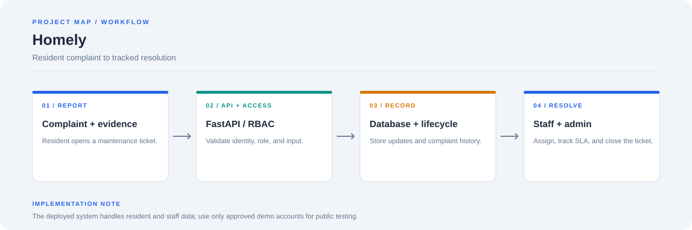
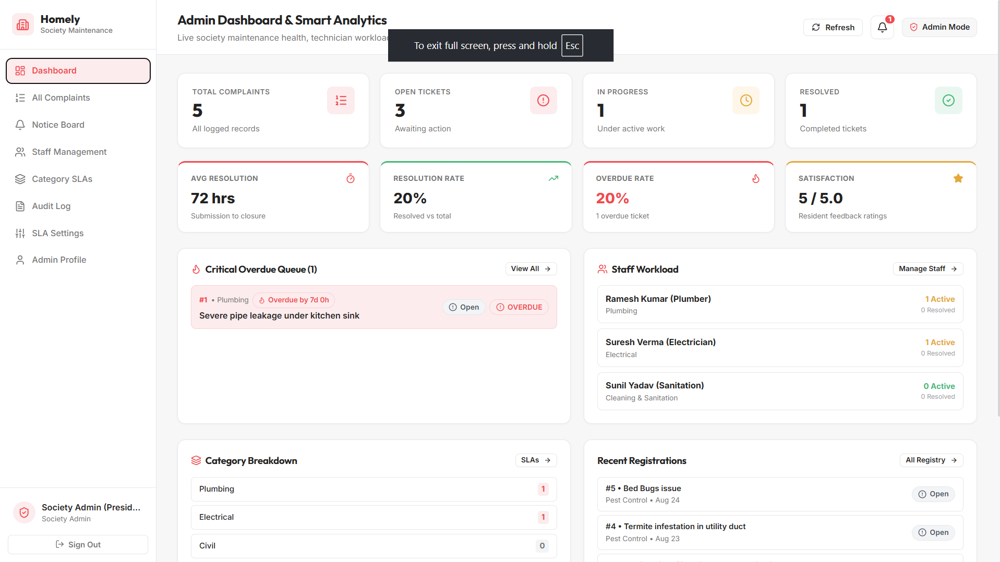
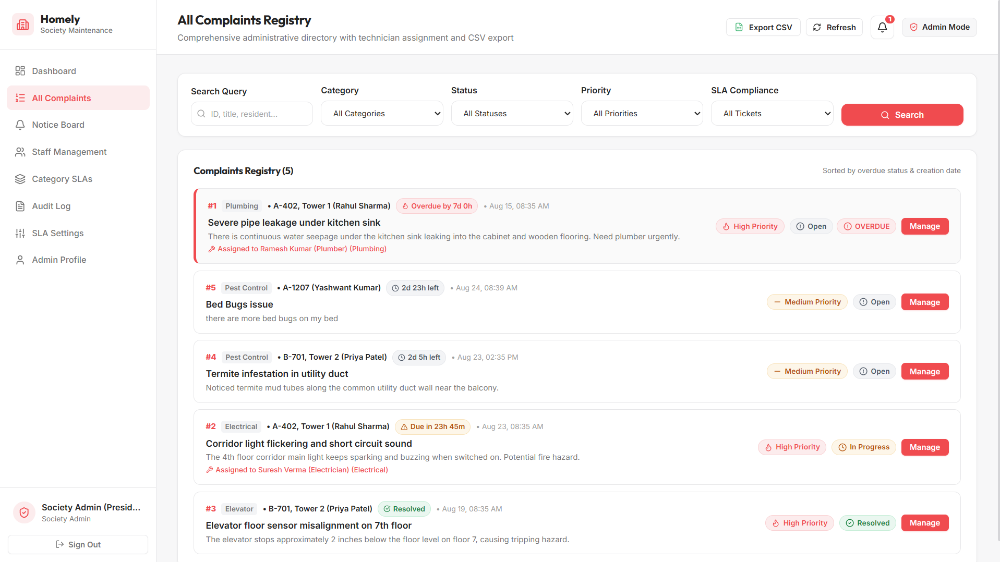
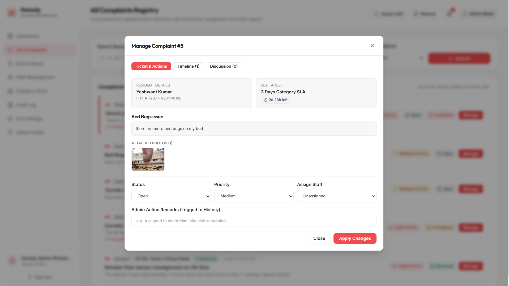
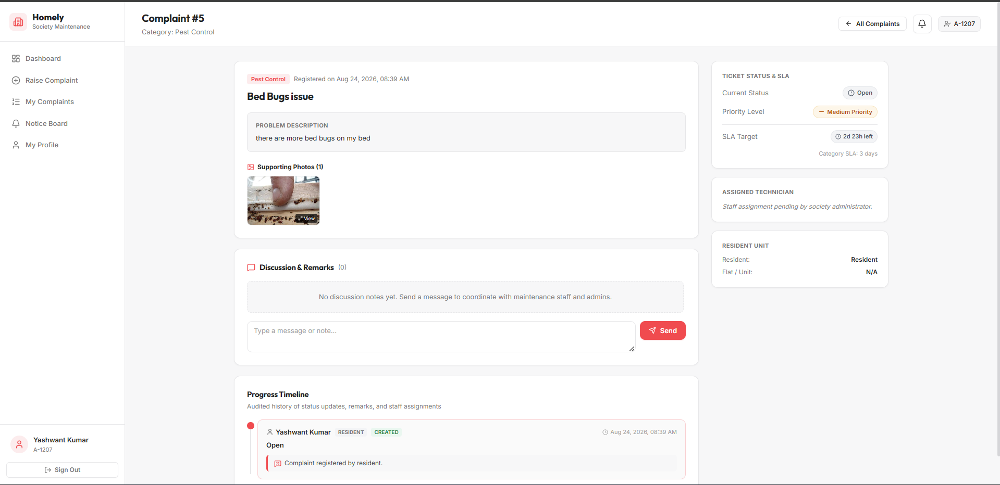
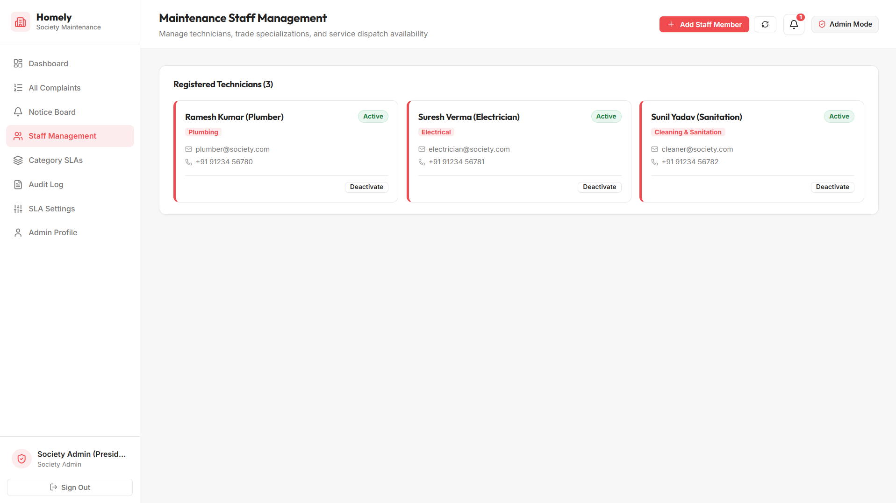
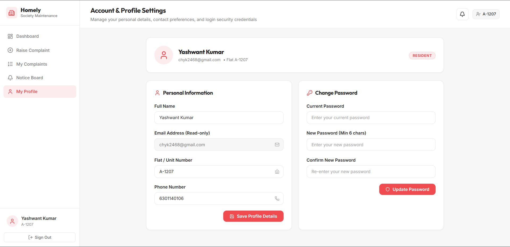
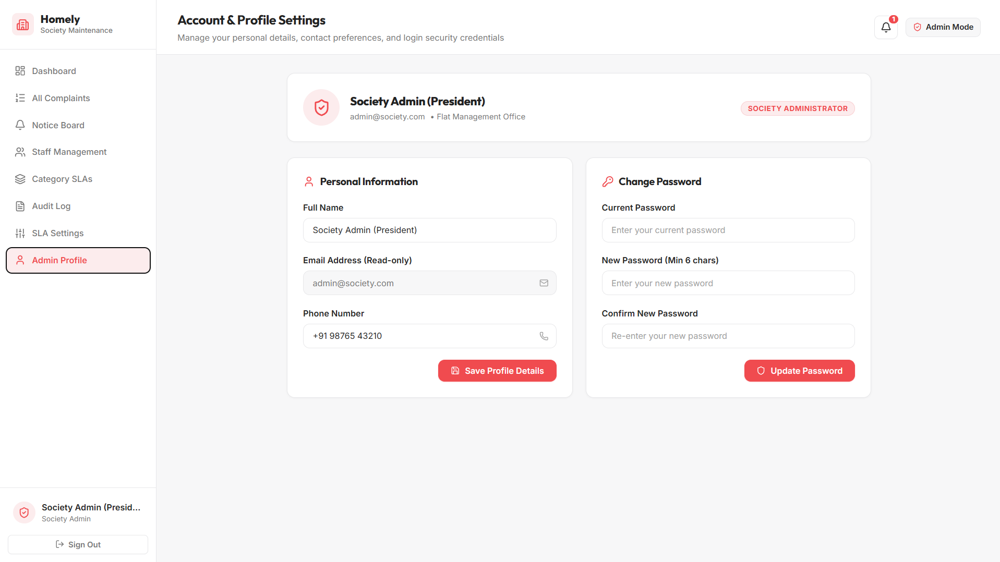
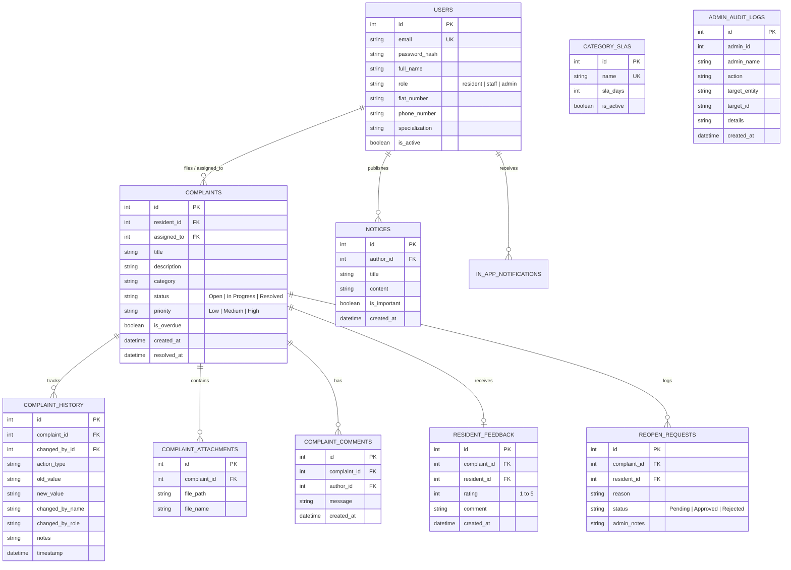

# 🏢 Homely — Society Maintenance Complaint Tracker & Operations CRM

> A modern, full-stack apartment society maintenance and complaint management platform designed for residents, maintenance staff technicians, and society administrators.



[](https://frontend-tau-eight-14.vercel.app/login)
[](https://fastapi.tiangolo.com/)
[](https://vitejs.dev/)
[](https://www.sqlalchemy.org/)
[](LICENSE)

🌐 **Live Deployed Application:** [https://frontend-tau-eight-14.vercel.app/login](https://frontend-tau-eight-14.vercel.app/login)

---

## 📌 1. Project Objective & Problem Statement

Apartment societies process continuous streams of resident maintenance complaints (plumbing leaks, electrical failures, elevator breakdowns, masonry seepage). Without a centralized system:
- **Administrators** have no visibility into pending workloads, overdue resolution deadlines, or recurring fault clusters across society wings.
- **Residents** lack visibility into ticket progress, technician dispatch status, and community announcements.
- **Technicians** lack direct assignment queues and contextual ticket notes.

**Homely** solves these challenges by providing:
1. **Resident Portal:** Multi-photo complaint submission with duplicate warning detection, live SLA countdowns, two-way ticket discussions, timeline tracking, and 5-star satisfaction ratings.
2. **Staff Technician Queue:** Trade-specific complaint queues, dispatch remarks, and work progress updates.
3. **Admin Operations CRM:** Full complaint registry, technician assignment, category SLA customization, automated overdue escalation, CSV reporting, audit logs, and smart analytics (recurring issue patterns).
4. **Community Notice Board:** Pinned urgent alerts with in-app notifications and email dispatch.

---

## 🔑 2. Demo Accounts

> 🚀 **Live Deployed App:** [https://frontend-tau-eight-14.vercel.app/login](https://frontend-tau-eight-14.vercel.app/login)
>
> You can try the live platform directly using any of the pre-seeded demo accounts below:

| Role | Email | Password | Access / Capabilities |
|---|---|---|---|
| **Resident** | `resident@society.com` | `resident123` | Raise tickets with photos, view complaint history, comment, rate service |
| **Maintenance Staff** | `plumber@society.com` | `staff123` | View assigned work orders, update repair progress to In Progress / Resolved |
| **Society Admin** | `admin@society.com` | `admin123` | Assign staff, configure category SLAs, export CSV reports, view analytics |

---

## 🚀 3. Scope of Work & Feature Set

### 🏠 Resident Experience
- **Complaint Submission with Media Uploads:** Categorize issues (Plumbing, Electrical, Elevator, Civil, Pest Control), set descriptions, and attach photo evidence.
- **Proactive Duplicate Detection:** Detects similar open complaints in the same category/location before submission to avoid redundant tickets.
- **Live Lifecycle Timeline:** Full chronological audit log with actor names, status transitions, and notes.
- **Two-Column Ticket View:** Left column for description, gallery, comments, and timeline; right column for SLA countdown badge, technician info, and actions.
- **Resident Satisfaction Ratings:** Submit 1–5 star ratings with feedback comments once complaints are marked *Resolved*.
- **Reopen Request Flow:** Request ticket reopening with justification if a resolved issue recurs.

### 🛠️ Maintenance Staff Workspace
- **Assigned Queue:** Dedicated work order list filtered to the logged-in technician.
- **Status Lifecycle Control:** Transition tickets to *In Progress* or *Resolved* with field remarks.

### ⚙️ Administrative CRM & Smart Analytics
- **Complaints Registry:** Multi-criteria search and filtering (by category, priority, status, SLA overdue).
- **Technician Dispatch:** Assign registered in-house staff or external vendors to open tickets.
- **Category-Specific SLAs:** Customize resolution windows (e.g. Lift: 1 Day, Plumbing: 2 Days, Civil: 5 Days).
- **Automated Overdue Escalation:** Automatically calculates deadlines and flags overdue tickets at the top of queues.
- **Recurring Issue Pattern Detection:** Automatically groups similar complaints over 30 days by location and category to flag recurring structural defects.
- **CSV Data Export:** One-click authenticated CSV download for society auditing.
- **Immutable Admin Audit Ledger:** Records every status change, staff assignment, SLA update, and notice publication.
- **Notice Board Broadcast:** Post general and pinned important notices with instant resident in-app notifications.

---

## 📸 4. Application UI Walkthrough & Visual Explanations

Here is a sorted visual tour of Homely's core user journeys across **Society Administrators**, **Residents**, and **Maintenance Staff Technicians**.

---

### 1. 📊 Executive Operations Dashboard & Smart Analytics
> **Primary Audience:** Society Administrators & Facility Managers



* **Key Highlights & Capabilities:**
  * **Real-Time Workload Metrics:** Live counter cards tracking **Total Complaints** (`5`), **Open Tickets** (`3` awaiting action), **In Progress** (`1` under active repair), and **Resolved** (`1` closed).
  * **SLA & Performance Analytics:** High-level KPIs measuring **Average Resolution Time** (`72 hrs`), **Resolution Rate** (`20%`), **Overdue Rate** (`20%`), and overall **Resident Satisfaction Score** (`5.0 / 5.0`).
  * **Critical Overdue Queue:** Automatic escalation alert card highlighting complaints that have breached their category SLA resolution windows (e.g. *Severe pipe leakage under kitchen sink — Overdue by 7d 0h*).
  * **Staff Workload Allocation:** Real-time visibility into active work orders assigned across specialized trades (Plumbing, Electrical, Sanitation).
  * **Category Frequency & Live Activity Stream:** Distribution of issues across society infrastructure and instant feeds of latest registrations.

---

### 2. 📋 Complaints Registry & Advanced Multi-Criteria Search
> **Primary Audience:** Society Administrators



* **Key Highlights & Capabilities:**
  * **Unified Complaint Registry:** Central administrative ledger displaying all resident tickets across society wings.
  * **Multi-Parameter Filter Engine:** Granular filtering by **Search Keyword** (Ticket ID, Title, Resident name), **Category** (Plumbing, Electrical, Elevator, Pest Control, Civil), **Status** (`Open`, `In Progress`, `Resolved`), **Priority** (`Low`, `Medium`, `High`), and **SLA Compliance** (`All`, `Within SLA`, `Overdue`).
  * **Live SLA Countdown Badges:** Contextual badges displaying dynamic time remaining before deadline expiration (e.g. `2d 23h left`, `Due in 23h 45m`) and immediate alert styling for overdue items (`Overdue by 7d 0h`).
  * **One-Click CSV Export:** Authenticated export button to generate CSV reports for society committee audits and monthly maintenance reviews.

---

### 3. ⚡ Technician Dispatch & Complaint Management Modal
> **Primary Audience:** Society Administrators



* **Key Highlights & Capabilities:**
  * **Quick-Action Dispatch Interface:** Seamlessly update complaint lifecycle status, re-evaluate priority level, and assign specialized in-house staff or external vendors.
  * **Contextual Resident & SLA Overview:** Instant visibility into resident identity, unit/flat number, contact details, and applicable category resolution SLA target.
  * **Attachment Inspection:** Embedded thumbnail preview of resident-submitted photo evidence.
  * **Audited Action Remarks:** Administrative notes field that logs custom remarks directly to the immutable history timeline upon status or assignment modification.
  * **Tabbed Deep-Dive:** Instant tabs to switch between *Ticket & Actions*, *Timeline History*, and *Discussion Thread*.

---

### 4. 🔍 Resident Ticket View, Photo Evidence & Audited Progress Timeline
> **Primary Audience:** Residents, Maintenance Staff & Administrators



* **Key Highlights & Capabilities:**
  * **Structured Two-Column Ticket View:** Left column houses the comprehensive problem description, high-resolution photo evidence gallery with expandable modal preview, and interactive conversation thread.
  * **Live SLA Target Tracker:** Right column displays real-time countdown timer, priority badge, and current technician assignment status.
  * **Two-Way Discussion Messaging:** Built-in communication channel allowing residents and maintenance staff to coordinate visit timings, gate clearances, and troubleshooting notes.
  * **Immutable Progress Timeline:** Step-by-step chronological audit trail recording exact timestamps, state transitions (`Created` ➔ `In Progress` ➔ `Resolved`), and actor attributions.

---

### 5. 🛠️ Maintenance Staff Management & Trade Roster
> **Primary Audience:** Society Administrators



* **Key Highlights & Capabilities:**
  * **Technician Directory:** Overview of all registered society technicians categorized by trade specializations (Plumbing, Electrical, Cleaning & Sanitation).
  * **Contact & Dispatch Availability:** Direct display of technician email addresses, phone contact numbers, and real-time active status badges.
  * **Staff Controls:** One-click account activation/deactivation and a `+ Add Staff Member` modal for fast technician onboarding.

---

### 6. 👤 Resident Account & Security Settings
> **Primary Audience:** Residents



* **Key Highlights & Capabilities:**
  * **Personal Profile Management:** Resident self-service portal to update Full Name, Flat/Unit Number, and Phone Number.
  * **Login Credentials & Password Security:** Secure self-service password update form with client-side and server-side validation.

---

### 7. 🛡️ Administrator Profile & Management Office Settings
> **Primary Audience:** Society Administrators



* **Key Highlights & Capabilities:**
  * **Role Verification:** Dedicated administrative profile badge (`SOCIETY ADMINISTRATOR`) confirming privileged access.
  * **Management Office Details:** Update official society administration contact numbers and office credentials.

---

## 📐 5. System Design & Architectural Write-Up (Max 800 Words)

### A. Complaint Lifecycle & Immutable History Model
Every complaint follows a strict state transition model: `Open` ➔ `In Progress` ➔ `Resolved` (with optional `Reopened` state).
```
   [ Open ] ───────────► [ In Progress ] ───────────► [ Resolved ]
      ▲                                                     │
      │                                                     ▼
      └─────────── [ Approved Reopen Request ] ◄─── (Feedback / Rating)
```
To guarantee accountability, complaints maintain a strict 1-to-many relationship with `complaint_history`. State transitions, priority shifts, technician assignments, and reopen reviews create immutable audit entries storing `action_type`, `old_value`, `new_value`, `changed_by_name`, `changed_by_role`, `notes`, and UTC `timestamp`. Residents only have read access to their own tickets (enforced via SQL user filtering), while administrators have full organizational oversight.

### B. Dynamic SLA & Overdue Detection Engine
Deadlines are calculated using category-specific SLAs (`complaint_categories.sla_days`) or the global society threshold (`settings.overdue_threshold_days`). Upon creation:

```text
Deadline = created_at + (Category SLA Days × 24 Hours)
```

The system evaluates overdue status dynamically on query execution and administrator updates:

```text
is_overdue = (status != "Resolved") AND (utcnow() > Deadline)
```

Overdue complaints are assigned priority in search queries and surfaced at the top of admin/staff dashboards with soft coral alert badges (`#FCECED` / `#F04B4F`).

### C. Photo Upload & Media Handling
Complaint attachments are validated for MIME type (`image/jpeg`, `image/png`, `image/webp`) and size limits. Files are saved to an isolated `/uploads` directory using UUID-prefixed filenames to prevent collisions and directory traversal attacks. File metadata and relational paths are recorded in `complaint_attachments` and served as static assets.

### D. Notification Flow & Notice Board
The system incorporates a multi-tier notification pipeline:
1. **In-App Notification Bell:** Instant notification records are stored in `in_app_notifications` with unread counter badges.
2. **Email Dispatch Pipeline:** When a ticket status changes or an administrative notice is marked **Important**, an asynchronous broadcast triggers email dispatches to affected residents.

---

## 🗄️ 6. Database Schema

The SQLite/PostgreSQL schema is normalized across 10 relational models:



---

## 📡 7. Complete REST API Reference

### 🔐 Authentication & Profile (`/api/auth`)
| Method | Endpoint | Access | Description |
|---|---|---|---|
| `POST` | `/api/auth/register` | Public | Register resident or admin account |
| `POST` | `/api/auth/login` | Public | Authenticate with email/password and obtain JWT |
| `GET` | `/api/auth/me` | Authenticated | Retrieve current user profile |
| `PUT` | `/api/auth/profile` | Authenticated | Update full name, phone, flat number, or change password |

### 📋 Complaints Management (`/api/complaints`)
| Method | Endpoint | Access | Description |
|---|---|---|---|
| `POST` | `/api/complaints` | Resident | Raise new ticket with multipart photo attachment |
| `POST` | `/api/complaints/check-duplicate` | Resident | Proactively check for potential duplicate complaints |
| `GET` | `/api/complaints` | Authenticated | List complaints (Residents see own; Admins see all) |
| `GET` | `/api/complaints/{id}` | Authenticated | Get ticket details, countdown SLA, photos, and assignments |
| `GET` | `/api/complaints/{id}/history` | Authenticated | Retrieve immutable lifecycle audit history |
| `PATCH` | `/api/complaints/{id}/status` | Admin/Staff | Update ticket status (`Open`, `In Progress`, `Resolved`) |
| `PATCH` | `/api/complaints/{id}/priority` | Admin | Update priority level (`Low`, `Medium`, `High`) |
| `GET` | `/api/complaints/{id}/comments` | Authenticated | Retrieve conversation thread |
| `POST` | `/api/complaints/{id}/comments` | Authenticated | Add message to ticket discussion |
| `POST` | `/api/complaints/{id}/feedback` | Resident | Submit 1–5 star rating and review on resolved tickets |
| `POST` | `/api/complaints/{id}/reopen-request` | Resident | Submit ticket reopen request with reason |

### 🛠️ Maintenance Staff (`/api/staff`)
| Method | Endpoint | Access | Description |
|---|---|---|---|
| `GET` | `/api/staff/complaints` | Staff | Retrieve complaints assigned to logged-in technician |
| `PATCH` | `/api/staff/complaints/{id}/status` | Staff | Update assigned work order status with field remarks |

### 👑 Administration & Smart Analytics (`/api/admin`)
| Method | Endpoint | Access | Description |
|---|---|---|---|
| `PATCH` | `/api/admin/complaints/{id}/assign` | Admin | Assign or reassign complaint to a staff technician |
| `GET` | `/api/admin/staff` | Admin | List all registered maintenance staff members |
| `POST` | `/api/admin/staff` | Admin | Onboard new technician with trade specialization |
| `PATCH` | `/api/admin/staff/{id}` | Admin | Activate/deactivate staff account or edit details |
| `GET` | `/api/admin/categories` | Admin | List category-specific SLA targets |
| `POST` | `/api/admin/categories` | Admin | Create new category with custom SLA window |
| `PUT` | `/api/admin/categories/{id}` | Admin | Update category SLA resolution days |
| `GET` | `/api/admin/reopen-requests` | Admin | List pending resident reopen requests |
| `PATCH` | `/api/admin/reopen-requests/{id}/review` | Admin | Approve or reject ticket reopen request |
| `GET` | `/api/admin/audit-logs` | Admin | Query immutable administrative event ledger |
| `GET` | `/api/admin/analytics/recurring-issues` | Admin | Detect recurring complaint clusters by location |
| `GET` | `/api/admin/reports/complaints/csv` | Admin | Export filtered complaint records as CSV report |
| `GET` | `/api/dashboard/stats` | Admin | Retrieve comprehensive dashboard analytics & metrics |

### 📢 Notices & Notifications (`/api/notices`, `/api/notifications`)
| Method | Endpoint | Access | Description |
|---|---|---|---|
| `GET` | `/api/notices` | Authenticated | List notice board announcements (pinned first) |
| `POST` | `/api/notices` | Admin | Publish notice with optional important pinned flag |
| `PUT` | `/api/notices/{id}` | Admin | Edit notice title, content, or pinned state |
| `DELETE` | `/api/notices/{id}` | Admin | Delete announcement |
| `GET` | `/api/notifications` | Authenticated | Get in-app notifications for current user |
| `GET` | `/api/notifications/unread-count` | Authenticated | Get badge count of unread notifications |
| `POST` | `/api/notifications/read-all` | Authenticated | Mark all notifications as read |

---

## 💻 8. Installation & Local Setup Guide

### Prerequisites
- **Python:** 3.10 or higher
- **Node.js:** 18.0 or higher
- **npm:** 9.0 or higher

---

### Step 1: Clone the Repository
```bash
git clone https://github.com/chyk2468/Homely.git
cd Homely
```

---

### Step 2: Backend Setup (FastAPI)
```bash
# 1. Navigate to backend directory
cd backend

# 2. Create and activate virtual environment
# Windows:
python -m venv venv
.\venv\Scripts\activate
# macOS/Linux:
python3 -m venv venv
source venv/bin/activate

# 3. Install backend dependencies
pip install -r requirements.txt

# 4. Copy environment configuration
cp .env.example .env

# 5. Start the FastAPI development server
uvicorn app.main:app --reload --port 8000
```
> Backend API will be live at `http://localhost:8000` (Interactive Swagger Docs at `http://localhost:8000/docs`).

---

### Step 3: Frontend Setup (React 19 + Vite)
In a separate terminal window:
```bash
# 1. Navigate to frontend directory
cd frontend

# 2. Install dependencies
npm install

# 3. Start Vite development server
npm run dev
```
> Frontend client will be running at `http://localhost:5173`.

---

## ⚙️ 9. Environment Variables (`.env.example`)

Create a `.env` file in `backend/` with the following variables:

```env
# Application Settings
PROJECT_NAME="Homely - Society Maintenance Complaint Tracker"
SECRET_KEY="super-secret-jwt-key-replace-in-production"
ALGORITHM="HS256"
ACCESS_TOKEN_EXPIRE_MINUTES=1440

# Database Connection (Defaults to SQLite; supports PostgreSQL)
DATABASE_URL="sqlite:///./society_complaints.db"

# CORS Allowed Origins
CORS_ORIGINS="http://localhost:5173,http://localhost:3000,https://homely-*.vercel.app"

# Overdue Escalation Default Threshold (Days)
DEFAULT_OVERDUE_THRESHOLD_DAYS=7

# Email Notification Service (Console / Mock / SMTP)
EMAIL_SERVICE_ENABLED=true
SMTP_SERVER="smtp.gmail.com"
SMTP_PORT=587
SMTP_USERNAME="notifications@society.com"
SMTP_PASSWORD="app-specific-password"
FROM_EMAIL="Homely Notifications <notifications@society.com>"
```

---

## 🧪 10. Automated Testing Suite

Homely includes automated unit and integration tests covering the complete complaint lifecycle, RBAC data isolation, SLA overdue calculations, duplicate detection, staff assignments, reopen workflows, and profile security:

```bash
# Run pytest in backend directory:
cd backend
pytest tests/ -v
```

**Test Coverage Summary:**
```
======================== 16 passed in ~20s ========================
✓ test_register_and_login_flow
✓ test_auth_me_endpoint
✓ test_create_complaint_with_photo
✓ test_resident_data_isolation
✓ test_admin_can_access_all_complaints
✓ test_status_and_priority_lifecycle
✓ test_category_specific_sla_overdue
✓ test_staff_role_and_assignment
✓ test_complaint_comments
✓ test_resident_satisfaction_feedback
✓ test_reopen_request_flow
✓ test_duplicate_complaint_detection
✓ test_in_app_notifications
✓ test_admin_search_and_csv_export
✓ test_dashboard_smart_analytics
✓ test_update_profile_and_password
```

---

## ☁️ 11. Production Deployment (Vercel & Render)

### 🚀 Live Deployment
- **Frontend App (Vercel):** [https://frontend-tau-eight-14.vercel.app/login](https://frontend-tau-eight-14.vercel.app/login)

### Frontend (Vercel)
1. Import repository `https://github.com/chyk2468/Homely.git` into [Vercel](https://vercel.com).
2. Set **Root Directory** to `frontend` (or root with bundled `vercel.json`).
3. Set Environment Variables:
   - `VITE_API_URL` ➔ `https://your-backend-api.onrender.com/api`
   - `VITE_API_ROOT` ➔ `https://your-backend-api.onrender.com`
4. Click **Deploy**. Single Page Application rewrites are pre-configured.

### Backend (Render / Railway)
1. Deploy a new Web Service pointing to `backend/`.
2. **Build Command:** `pip install -r requirements.txt`
3. **Start Command:** `uvicorn app.main:app --host 0.0.0.0 --port $PORT`

---

## 📄 License
This project is licensed under the MIT License — see the [LICENSE](LICENSE) file for details.
