# 🏢 Homely — Society Maintenance Complaint Tracker & Operations CRM

A modern, production-grade full-stack platform where apartment residents raise and track maintenance complaints with photos, maintenance staff resolve assigned work orders, and society administrators govern complaints through an audited lifecycle with custom category SLAs, smart analytics, duplicate prevention, discussion threads, reopen requests, resident satisfaction ratings, and CSV reporting.

---

## 🌟 Core & Advanced Features (All 14 Implemented)

### 1. 👷 Maintenance Staff Role & Work Order Dispatch
- **Dedicated Role (`staff`):** Technicians have specialized accounts with designated trades (Plumbing, Electrical, Civil, Elevator, Pest Control, Cleaning & Sanitation, Carpentry).
- **Complaint Assignment:** Admins assign specific tickets to staff members; staff accounts get a dedicated dashboard and operational work queue (`/staff/dashboard`, `/staff/my-assigned`).
- **Status Progression & Work Notes:** Staff update complaint status from `Open` to `In Progress` or `Resolved` and record maintenance remarks.

### 2. 💬 Complaint Comments / Multi-Party Discussion Thread
- **Interactive Ticket Discussion:** Real-time conversation thread between Resident, Assigned Staff, and Administrators directly on each complaint.
- **Role Badges & Timestamps:** Clear visual badges distinguishing Resident (`#818cf8`), Staff (`#a78bfa`), and Admin (`#06b6d4`) messages with exact timestamps.
- **Automatic History Logging:** Adding discussion notes captures `COMMENT_ADDED` action records in the immutable audit ledger.

### 3. ⏱️ Dynamic SLA Countdown & Status Badges
- **Real-Time Countdown:** Dynamically calculates time remaining until resolution deadline or overdue duration (`Due in 18h`, `2d 4h remaining`, `Overdue by 1d 6h`).
- **Visual Alert States:** Normal (cyan/emerald), Approaching Deadline (&le; 24h: amber), and Overdue (rose/red flame badge).

### 4. 🗂️ Category-Specific SLA Configuration
- **Granular SLA Windows:** Admins configure distinct SLA resolution windows per category (e.g. Elevator: 1 day, Plumbing: 2 days, Electrical: 2 days, Civil: 4 days, Other: 7 days).
- **Live Recalculation:** Modifying a category SLA immediately updates deadlines and re-evaluates overdue states database-wide.

### 5. 📊 Smart Admin Analytics
- **Average Resolution Time:** Computed average hours taken from ticket submission to verified resolution.
- **Resolution & Overdue Rates:** Instant calculation of % resolved tickets and % overdue tickets.
- **Staff Workload & Productivity:** Breakdown of active and resolved ticket counts per technician.
- **Resident Satisfaction Metrics:** Average star rating and rating distribution.

### 6. ⭐ Resident Satisfaction Feedback
- **5-Star Rating & Review Modal:** Once a complaint is resolved, residents can submit a 1 to 5-star rating with optional comments.
- **One Rating Per Ticket:** Strictly prevents duplicate feedback submissions and ensures ratings are submitted only for resolved tickets.

### 7. 🔄 Reopen Request Lifecycle
- **Resident Reopen Submissions:** If an issue is not fully fixed or re-occurs, residents can submit a formal reopen request with reasons.
- **Admin Review Workflow:** Admins review pending reopen requests (`Approve` &rarr; moves ticket to `In Progress` with `REOPENED` history tag; `Reject` &rarr; stays `Resolved` with `REOPEN_REJECTED` history tag).

### 8. 🔍 Duplicate Complaint Detection
- **Non-Blocking Recommendation:** Before submitting a new complaint, the system analyzes recent tickets (past 30 days) in the same category for keyword/token similarity.
- **Warning Dialog:** Displays potential duplicates with an option to "View Existing" or "Submit Anyway".

### 9. 📍 Recurring Issue & Hotspot Detection
- **Clustering Analytics:** Analyzes category, flat, and tower patterns over 30-day windows to detect recurring infrastructure failures.
- **Preventative Recommendations:** Highlights problem areas on the admin dashboard with recommendations for preventative maintenance.

### 10. 🔔 In-App Notifications
- **Floating Notification Bell:** Real-time badge counter indicating unread notices, assignment changes, and ticket updates.
- **Interactive Dropdown:** Mark individual notifications as read or use "Mark all read".

### 11. 🔎 Multi-Field Admin Search
- **Comprehensive Search Engine:** Search across Ticket ID, title, description, resident name, resident email, flat number, and assigned staff member.

### 12. 📷 Multi-Photo Attachments (Up to 5 Photos)
- **High-Capacity Attachments:** Residents can upload up to 5 photos per complaint (up to 10MB each).
- **Secure Handling:** Validates image MIME types (`PNG`, `JPG`, `JPEG`, `WEBP`), assigns unique cryptographic UUIDs, and renders thumbnails with a full-screen lightbox preview.

### 13. 📜 Administrative Audit Log
- **Immutable Ledger:** Records all administrative mutations, user creations, staff assignments, SLA updates, notices, and reopen decisions with timestamp and admin actor name.
- **Dedicated Audit Trail UI:** Accessible under `/admin/audit-logs`.

### 14. 📑 Export Reports (CSV Download)
- **CSV Export:** Admins can export filtered complaint registries with complete metadata, timestamps, resident info, assigned technician, and resolution status with one click.

---

## 🏛️ System Architecture

```mermaid
flowchart TB
    subgraph ClientTier["🖥️ Presentation Layer (React 19 SPA + Vite 8)"]
        direction TB
        subgraph ResidentUI["Resident Portal"]
            R1["New Complaint (Multi-Photo + Duplicate Check)"]
            R2["My Complaints & SLA Badges"]
            R3["Discussion Thread & Feedback Modal"]
            R4["Reopen Request Flow"]
        end
        subgraph StaffUI["Staff Workspace"]
            S1["Staff Dashboard (Active Queue)"]
            S2["Assigned Complaints & Remarks"]
            S3["Discussion Thread Participation"]
        end
        subgraph AdminUI["Admin Operations Portal"]
            A1["Smart Analytics & Workload Breakdown"]
            A2["All Complaints (Search, Assign, CSV)"]
            A3["Category SLAs & Overdue Engine"]
            A4["Staff Management & Audit Logs"]
            A5["Reopen Reviews & Notices"]
        end
        subgraph SharedUI["Shared Client Core"]
            C1["AuthContext (Resident / Staff / Admin RBAC)"]
            C2["ApiClient (REST & CSV Streamer)"]
            C3["NotificationDropdown & Bell Badge"]
            C4["Design System (CSS Tokens & Glassmorphism)"]
        end
    end

    subgraph APITier["⚡ API Gateway (FastAPI + Python 3.11)"]
        direction TB
        GW["FastAPI Router & CORS Middleware"]
        SEC["JWT Bearer Authentication & RBAC Dependencies"]
        
        subgraph Routers["Modular Sub-Routers"]
            SR1["/api/auth (Login, Register, Me)"]
            SR2["/api/complaints (CRUD, Duplicate, Comments, Feedback, Reopen)"]
            SR3["/api/staff (Assigned Queue & Status Updates)"]
            SR4["/api/admin (Staff, Category SLAs, Audit Logs, Recurring, CSV)"]
            SR5["/api/notices (Board & Notifications)"]
            SR6["/api/notifications (Unread, Read All)"]
            SR7["/api/dashboard (Smart Analytics & Workload)"]
            SR8["/api/settings (Overdue Threshold)"]
        end

        subgraph Engines["Core Services"]
            BE1["AuthService (BCrypt & JWT HS256)"]
            BE2["Complaint & History Engine"]
            BE3["Category Overdue SLA Engine"]
            BE4["Notification & Audit Logger"]
            BE5["Multi-File Storage Pipeline"]
            BE6["Email Service (Resend REST API)"]
        end
    end

    subgraph DataTier["💾 Persistence Tier (SQLAlchemy 2.0 ORM)"]
        direction LR
        subgraph RelationalDB["Relational Database (SQLite / PostgreSQL)"]
            DB1[("users\n(resident, staff, admin)")]
            DB2[("complaints & attachments")]
            DB3[("complaint_history")]
            DB4[("complaint_comments")]
            DB5[("complaint_feedback")]
            DB6[("reopen_requests")]
            DB7[("complaint_categories")]
            DB8[("notifications")]
            DB9[("admin_audit_logs")]
            DB10[("notices & settings")]
        end
        subgraph FileStore["File Storage"]
            FS1["/uploads (UUID Photo Attachments)"]
        end
    end

    ResidentUI --> SharedUI
    StaffUI --> SharedUI
    AdminUI --> SharedUI
    SharedUI -- "REST / JSON & Multipart" --> GW
    GW --> SEC
    SEC --> Routers
    Routers --> Engines
    Engines --> RelationalDB
    Engines --> FileStore
```



---

## 🔑 Demo Accounts & 1-Click Login

The login page provides **1-Click Instant Demo Login** buttons:

| Role | Email | Password | Details / Specialization |
|---|---|---|---|
| **Society Admin** | `admin@society.com` | `admin123` | Management Office (Full Access) |
| **Maintenance Staff** | `plumber@society.com` | `staff123` | Ramesh Kumar (Plumbing Specialist) |
| **Maintenance Staff** | `electrician@society.com` | `staff123` | Suresh Verma (Electrical Specialist) |
| **Resident 1** | `resident@society.com` | `resident123` | Rahul Sharma (Flat A-402, Tower 1) |
| **Resident 2** | `priya@society.com` | `resident123` | Priya Patel (Flat B-701, Tower 2) |

---

## 🚀 Quickstart Guide

### ⚡ Windows 1-Click Startup (Recommended)
Double-click or run:
```cmd
start.bat
```
> Starts FastAPI (:8000) and Vite React (:5173), opens the browser, and sets up the database. Run `stop.bat` to shut down all processes.

---

### Manual Setup

#### 1. Backend Setup
```bash
cd backend
python -m venv venv

# Windows:
.\venv\Scripts\activate
# Linux/macOS:
source venv/bin/activate

pip install -r requirements.txt
uvicorn app.main:app --reload --port 8000
```
Interactive API Documentation: **http://localhost:8000/docs**

#### 2. Frontend Setup
```bash
cd frontend
npm install
npm run dev
```
Open browser at: **http://localhost:5173**

---

## 🧪 Automated Testing

Run the full automated pytest suite (15 test suites covering all business rules and advanced features):

```bash
cd backend
.\venv\Scripts\pytest -v
```

### Tested Scenarios:
1. `test_health_check`: API liveness probe.
2. `test_resident_registration_and_login`: JWT token lifecycle.
3. `test_resident_create_complaint_with_photo`: Multi-part photo upload, Category SLA deadline calculations.
4. `test_resident_data_isolation`: Strict 403 Forbidden enforcement on cross-resident complaints and audit history.
5. `test_admin_can_access_all_complaints`: Admin cross-tenant visibility.
6. `test_status_and_priority_lifecycle`: Status and priority changes with immutable history entries.
7. `test_category_specific_sla_overdue`: Dynamic overdue calculations per category SLA.
8. `test_staff_role_and_assignment`: Staff queue, work order dispatch, and staff status update.
9. `test_complaint_comments`: Multi-party discussion thread with role attribution.
10. `test_resident_satisfaction_feedback`: 5-star rating submission (resolved-only and duplicate prevention).
11. `test_reopen_request_flow`: Resident reopen request, admin review and status transition to `In Progress`.
12. `test_duplicate_complaint_detection`: Keyword similarity detection.
13. `test_in_app_notifications`: Notification generation, unread counts, and mark-as-read.
14. `test_admin_search_and_csv_export`: Multi-criteria search and CSV report export.
15. `test_dashboard_smart_analytics`: Resolution rate, average resolution hours, and staff workload analytics.

---

## 📡 Complete REST API Reference

### Authentication (`/api/auth`)
| Method | Endpoint | Role | Description |
|---|---|---|---|
| `POST` | `/api/auth/register` | Public | Register new resident account |
| `POST` | `/api/auth/login` | Public | Login and obtain JWT bearer token |
| `GET` | `/api/auth/me` | Authenticated | Get current authenticated user details |

### Complaints (`/api/complaints`)
| Method | Endpoint | Role | Description |
|---|---|---|---|
| `POST` | `/api/complaints` | Resident | Raise new complaint (with up to 5 photos) |
| `POST` | `/api/complaints/check-duplicate` | Authenticated | Check for potential duplicate tickets |
| `GET` | `/api/complaints` | Authenticated | List complaints (Resident: own; Admin: all) |
| `GET` | `/api/complaints/categories` | Public | List complaint categories |
| `GET` | `/api/complaints/{id}` | Authenticated | Get complaint detail (ownership enforced) |
| `GET` | `/api/complaints/{id}/history` | Authenticated | Get complaint audit timeline |
| `POST` | `/api/complaints/{id}/comments` | Authenticated | Post a comment to the discussion thread |
| `GET` | `/api/complaints/{id}/comments` | Authenticated | Get comments for a complaint |
| `POST` | `/api/complaints/{id}/feedback` | Resident | Submit 1-5 star satisfaction feedback |
| `GET` | `/api/complaints/{id}/feedback` | Authenticated | Get satisfaction feedback |
| `POST` | `/api/complaints/{id}/reopen-request`| Resident | Request reopening of a resolved ticket |

### Staff Operations (`/api/staff`)
| Method | Endpoint | Role | Description |
|---|---|---|---|
| `GET` | `/api/staff/complaints` | Staff | List complaints assigned to current staff member |
| `PATCH`| `/api/staff/complaints/{id}/status` | Staff | Update operational status and add work notes |

### Administration (`/api/admin`)
| Method | Endpoint | Role | Description |
|---|---|---|---|
| `GET` | `/api/admin/complaints` | Admin | Query and search all complaints |
| `PATCH`| `/api/admin/complaints/{id}/assign` | Admin | Assign complaint to a staff member |
| `PATCH`| `/api/admin/complaints/{id}/status` | Admin | Change status and record audit log |
| `PATCH`| `/api/admin/complaints/{id}/priority`| Admin | Change priority and record audit log |
| `GET` | `/api/admin/staff` | Admin | List all maintenance staff accounts |
| `POST` | `/api/admin/staff` | Admin | Create a new maintenance staff account |
| `PATCH`| `/api/admin/staff/{id}` | Admin | Update staff details / active status |
| `GET` | `/api/admin/categories` | Admin | List category SLA configurations |
| `POST` | `/api/admin/categories` | Admin | Create a new category SLA |
| `PUT` | `/api/admin/categories/{id}` | Admin | Update category SLA days & recalculate |
| `GET` | `/api/admin/reopen-requests` | Admin | List pending reopen requests |
| `PATCH`| `/api/admin/reopen-requests/{id}/review` | Admin | Approve or reject a reopen request |
| `GET` | `/api/admin/audit-logs` | Admin | View immutable administrative audit trail |
| `GET` | `/api/admin/analytics/recurring-issues`| Admin | Identify recurring complaint clusters |
| `GET` | `/api/admin/reports/complaints/csv` | Admin | Export complaint registry as CSV |

### In-App Notifications (`/api/notifications`)
| Method | Endpoint | Role | Description |
|---|---|---|---|
| `GET` | `/api/notifications` | Authenticated | List user's notifications |
| `GET` | `/api/notifications/unread-count` | Authenticated | Get integer unread notification count |
| `PATCH`| `/api/notifications/{id}/read` | Authenticated | Mark single notification as read |
| `POST` | `/api/notifications/read-all` | Authenticated | Mark all notifications as read |

### Notice Board (`/api/notices`)
| Method | Endpoint | Role | Description |
|---|---|---|---|
| `GET` | `/api/notices` | Public | List notices (Important pinned to top) |
| `POST` | `/api/notices` | Admin | Create notice (dispatches in-app & email) |
| `PUT` | `/api/notices/{id}` | Admin | Update notice details |
| `DELETE`| `/api/notices/{id}` | Admin | Delete notice announcement |

### Dashboard & Analytics (`/api/dashboard`)
| Method | Endpoint | Role | Description |
|---|---|---|---|
| `GET` | `/api/dashboard/summary` | Admin | Summary KPI statistics |
| `GET` | `/api/dashboard/stats` | Admin | Full smart analytics & workload distribution |

---

## 🔒 Security & Data Integrity

1. **Password Hashing:** Passwords are never stored in plaintext and are hashed using bcrypt with salted rounds.
2. **Stateless JWT Authorization:** Bearer JWT tokens signed with HS256; RBAC role checks enforced on every secured endpoint.
3. **Data Isolation:** Residents can strictly access only complaints they raised (`403 Forbidden` on unauthorized queries).
4. **File Safety:** Photo uploads strictly validate MIME types, max file size (&le; 10MB), and sanitize file names with `UUIDv4` hashes to eliminate directory traversal.
5. **Non-Blocking Notifications:** Email delivery failures never block or roll back database transactions.
