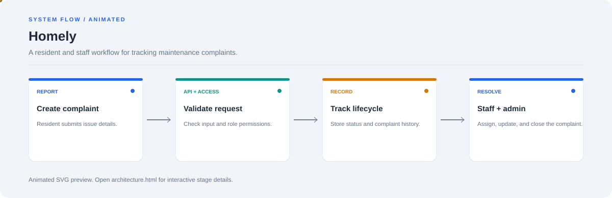

# Homely

**A resident and staff workflow for tracking maintenance complaints.**

[](https://github.com/chyk2468/Homely)

## 1. Project Title & Tagline

A resident and staff workflow for tracking maintenance complaints.

## 2. Problem Statement

Maintenance complaints can be lost across messages and manual follow-ups. Homely structures complaint reporting, assignment, status changes, and resolution tracking.

## 3. Project Preview

Add a screenshot or GIF showing a representative workflow and its output. Remove sensitive or private information from any demo data.

[Open interactive architecture](architecture.html)

## 4. Overview

The project moves from source input through its core processing stages to a result that can be reviewed. The workflow below shows the main system boundaries.

## 5. Key Features

- Create and view maintenance complaints.
- Support resident, staff, and admin workflows where configured.
- Track complaint status and assignment.
- Organise updates through a shared application interface.

## 6. Architecture / Workflow



Open the [interactive architecture explorer](architecture.html) to select a stage and inspect its role.

## 7. Tech Stack

Frontend framework and FastAPI/backend stack specified by the repository, with its configured database and auth libraries

## 8. Installation & Setup

```bash
git clone https://github.com/chyk2468/Homely.git
cd Homely
```

Follow the frontend and backend setup files separately. Configure local environment variables and the database before starting services.

## 9. Usage

Start the backend and frontend using the documented commands, use demo accounts, create a sample complaint, and verify status changes and role permissions.

## 10. Project Structure

Inspect the frontend app, FastAPI routes, data models, authentication/role checks, and database configuration.

## 11. Results & Demo

Add screenshots of complaint creation, staff assignment, and resolution status. Link the live demo only if it is currently deployed and tested.

## 12. Future Enhancements

- Add audit logs and notifications.
- Improve SLA tracking and filtering.
- Add integration tests for role permissions.
- Improve accessibility and mobile forms.

## 13. License

Check the repository and dependency licences before reuse. Avoid placing real resident details in public screenshots.
