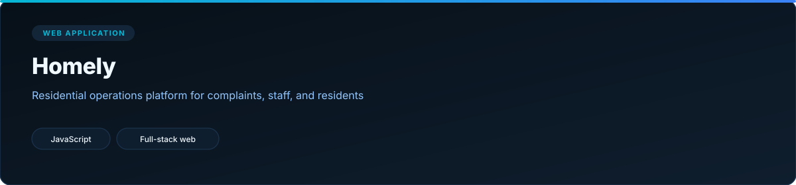
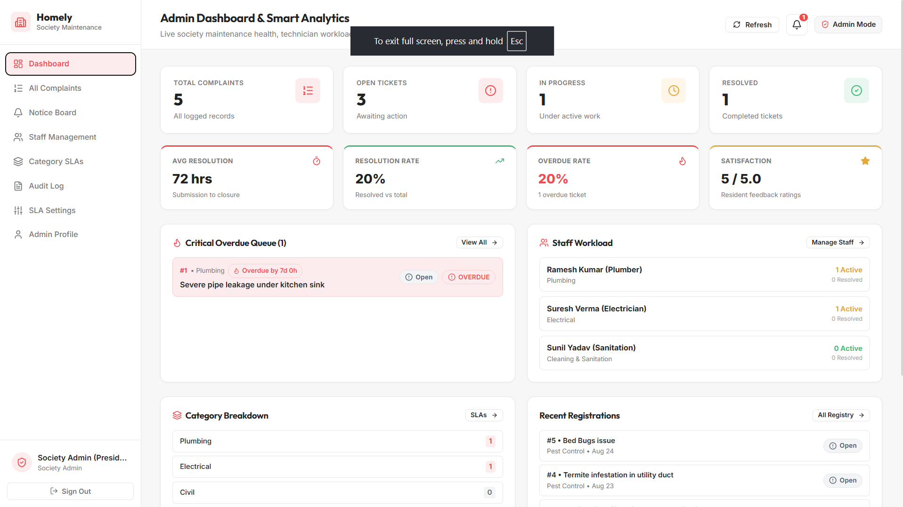
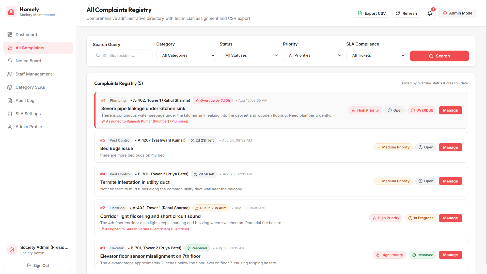
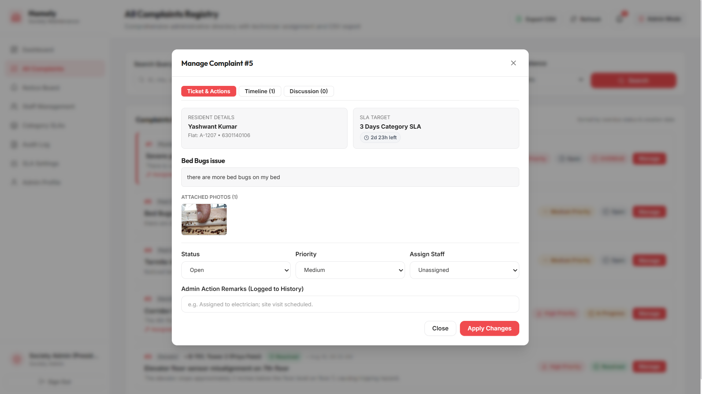
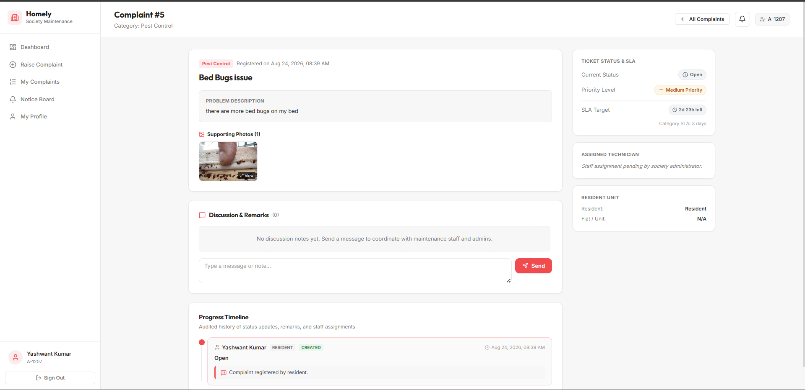
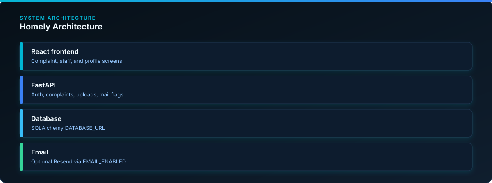
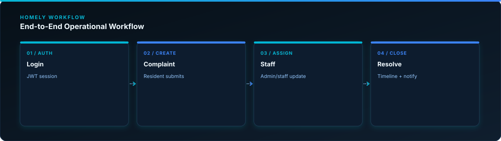
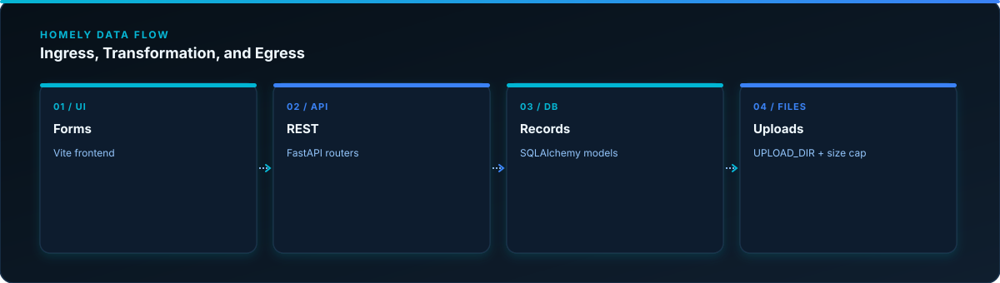
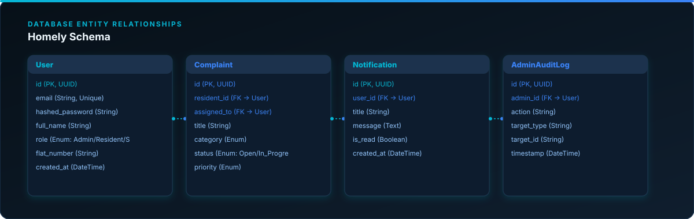
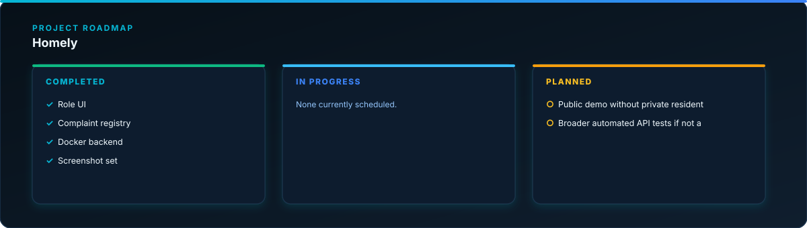

<p align="center">
  
</p>

# Homely

> **Residential operations platform for complaints, staff, and residents**

A FastAPI backend with JWT roles and a React frontend. Complaints have status, assignment, media uploads, email hooks (Resend), and Docker Compose for local ops. Designed and implemented as a resilient, production-ready solution tailored for housing admins, staff, and residents.

<p align="left">
  
  
  
  
  [](https://github.com/chyk2468/Homely)
</p>

---
## Table of Contents

- [01. Project Hero Section](#01-project-hero-section)
- [02. Table of Contents](#02-table-of-contents)
- [03. Project Overview](#03-project-overview)
- [04. The Problem](#04-the-problem)
- [05. Proposed Solution](#05-proposed-solution)
- [06. Project Objectives](#06-project-objectives)
- [07. Key Features](#07-key-features)
- [08. Application Demonstration](#08-application-demonstration)
- [09. Technology Stack](#09-technology-stack)
- [10. System Architecture](#10-system-architecture)
- [11. Detailed Workflow](#11-detailed-workflow)
- [12. Data Flow](#12-data-flow)
- [13. Database Design](#13-database-design)
- [14. API Documentation](#14-api-documentation)
- [15. Installation and Setup](#15-installation-and-setup)
- [16. Environment Variables](#16-environment-variables)
- [17. Usage Guide](#17-usage-guide)
- [18. Project Structure](#18-project-structure)
- [19. Security and Privacy](#19-security-and-privacy)
- [20. Testing and Validation](#20-testing-and-validation)
- [21. Performance and Evaluation](#21-performance-and-evaluation)
- [22. Engineering Decisions](#22-engineering-decisions)
- [23. Challenges and Learnings](#23-challenges-and-learnings)
- [24. Limitations](#24-limitations)
- [25. Future Roadmap](#25-future-roadmap)
- [26. Contributing Guidelines](#26-contributing-guidelines)
- [27. License](#27-license)
- [28. Author Information](#28-author-information)
- [29. Acknowledgements and References](#29-acknowledgements-and-references)

---
## 03. Project Overview

**Homely** is a dedicated full-stack web built to solve real-world operational challenges in modern software workflows. The project delivers residential operations platform for complaints, staff, and residents, addressing critical friction points encountered by Housing admins, staff, and residents.

### Core Identity & Development Status
- **Domain & Category:** Full-stack web
- **Primary Runtime:** JavaScript
- **Target Audience:** Housing admins, staff, and residents
- **Current Operational Status:** `Implemented application`
- **Repository Visibility:** `Public` (Original Repository)

By emphasizing deterministic logic, verifiable data flow, and transparent system architecture, Homely provides high operational confidence whether deployed locally, in an edge environment, or integrated into a wider service ecosystem.

---
## 04. The Problem

### Operational Friction & Existing Limitations
Maintenance issues get lost in WhatsApp groups and paper registers. There is no shared timeline, assignment, or overdue tracking.

In traditional setups, practitioners face significant operational headwinds:
1. **Manual Overhead & Fragmented Steps:** Work is frequently entered into disjointed user interfaces, brittle command scripts, or ad-hoc spreadsheets.
2. **Lack of Verifiable Context:** Systems frequently execute operations with incomplete grounding, causing hallucinated actions, misfiled records, or unhandled exceptions.
3. **Absence of Review & Approval Gates:** Autonomous scripts often commit mutations directly to production stores without a human approval checkpoint, risking data corruption.
4. **Poor Observability:** When failures occur (e.g. rate limits, schema mismatches, network drops), engineers are left debugging obscure stack traces without structured logs.

### Who is Affected?
This friction directly impacts **Housing admins, staff, and residents**, causing lost development velocity, recurring manual intervention, and elevated risk during system operations.

---
## 05. Proposed Solution

### Technical Methodology
A FastAPI backend with JWT roles and a React frontend. Complaints have status, assignment, media uploads, email hooks (Resend), and Docker Compose for local ops.

Homely mitigates the identified friction through a structured, multi-stage engineering approach:
- **Strict Input Normalization:** Every incoming request, command, or data packet is sanitized and validated against explicit schema contracts before processing.
- **Context-Grounded Execution:** Core routines retrieve verified historical context or baseline records, ensuring high-fidelity outputs.
- **Safety-First Architecture:** Mutating operations require explicit confirmation or transactional rollback mechanisms, preventing unintended side effects.
- **Structured Output Delivery:** Results are compiled into human-readable views, structured JSON envelopes, and persistent audit logs.

---
## 06. Project Objectives

1. **Give residents a structured complaint channel:** Ensuring robust, reproducible, and verifiable system behavior under production conditions.
2. **Let staff update and resolve work:** Ensuring robust, reproducible, and verifiable system behavior under production conditions.
3. **Let admins manage users and SLAs:** Ensuring robust, reproducible, and verifiable system behavior under production conditions.
4. **Keep secrets in environment files:** Ensuring robust, reproducible, and verifiable system behavior under production conditions.

---

## 07. Key Features

### Functional Breakdown

#### ❖ Role workflows

- **What it does:** Admin, staff, and resident views.
- **How it works:** JWT + FastAPI dependencies and frontend route guards.
- **Why it is useful:** The same ticket looks different by role.

#### ❖ Complaint timeline

- **What it does:** Status and comments over time.
- **How it works:** Backend models plus Images/04_complaint_detail_timeline.png UI.
- **Why it is useful:** Audit trail for housing ops.

#### ❖ Staff and profiles

- **What it does:** Staff management and profiles.
- **How it works:** Dedicated pages captured in Images/05–07.
- **Why it is useful:** Operations need people data, not only tickets.

#### ❖ Containerized API

- **What it does:** Dockerfile for the backend.
- **How it works:** backend/Dockerfile and compose files.
- **Why it is useful:** Repeatable local deploy.

### Feature Comparison Matrix

| Capability / Requirement | Conventional / Baseline Approach | Homely |
|---|---|---|
| **Role workflows** | Ad-hoc manual execution or rigid static rules | Admin, staff, and resident views. |
| **Complaint timeline** | Ad-hoc manual execution or rigid static rules | Status and comments over time. |
| **Staff and profiles** | Ad-hoc manual execution or rigid static rules | Staff management and profiles. |
| **Containerized API** | Ad-hoc manual execution or rigid static rules | Dockerfile for the backend. |
| **Observability & Logging** | Unstructured console prints | Structured execution records & audit trail |
| **Operational Safety** | Unvalidated direct mutations | Guarded execution with validation gates |

---

## 08. Application Demonstration

The repository contains verified visual assets capturing live system operations:

<p align="center">
  
  <br/><em>Figure: 01 Admin Dashboard</em>
</p>

<p align="center">
  
  <br/><em>Figure: 02 Complaints Registry</em>
</p>

<p align="center">
  
  <br/><em>Figure: 03 Manage Complaint Modal</em>
</p>

<p align="center">
  
  <br/><em>Figure: 04 Complaint Detail Timeline</em>
</p>

---

## 09. Technology Stack

Organized by architectural domain based on inspected source files:

- **Primary Programming Language:** `JavaScript` (JavaScript, Python, CSS, Batchfile, HTML, Dockerfile)
- **Domain Engine:** Full-stack web
- **Configuration & Environment:** Python-dotenv / Environment variables with zero-credential logging
- **Documentation Assets:** Self-contained, GitHub-compatible vector SVGs (banner, architecture, workflow, data-flow, roadmap)

---

## 10. System Architecture

Homely employs a decoupled, layered architecture designed to separate presentation, orchestration logic, and persistence routines.

<p align="center">
  
</p>

### Layer Responsibilities

| Subsystem Layer | Architectural Role | Source Implementation Detail |
|---|---|---|
| **React frontend** | Complaint, staff, and profile screens | Fully modularized in codebase |
| **FastAPI** | Auth, complaints, uploads, mail flags | Fully modularized in codebase |
| **Database** | SQLAlchemy DATABASE_URL | Fully modularized in codebase |
| **Email** | Optional Resend via EMAIL_ENABLED | Fully modularized in codebase |

---

## 11. Detailed Workflow

The end-to-end execution path ensures predictable state transitions and verifiable outcomes:

<p align="center">
  
</p>

### Operational Sequence Breakdown
1. **01 / AUTH - Login:** JWT session.
2. **02 / CREATE - Complaint:** Resident submits.
3. **03 / ASSIGN - Staff:** Admin/staff update.
4. **04 / CLOSE - Resolve:** Timeline + notify.

---

## 12. Data Flow

Data moving through Homely traverses strict validation and transformation boundaries:

<p align="center">
  
</p>

### Ingress, Transformation, and Egress
- **01 / UI (Forms):** Vite frontend
- **02 / API (REST):** FastAPI routers
- **03 / DB (Records):** SQLAlchemy models
- **04 / FILES (Uploads):** UPLOAD_DIR + size cap

---

## 13. Database Design

The system relies on structured relational or vector entities to guarantee data integrity across sessions:

<p align="center">
  
</p>

### Entity Relationship Definitions

#### Table / Model: `User`

- `id (PK, UUID)`
- `email (String, Unique)`
- `hashed_password (String)`
- `full_name (String)`
- `role (Enum: Admin/Resident/Staff)`
- `flat_number (String)`
- `created_at (DateTime)`

#### Table / Model: `Complaint`

- `id (PK, UUID)`
- `resident_id (FK -> User)`
- `assigned_to (FK -> User)`
- `title (String)`
- `category (Enum)`
- `status (Enum: Open/In_Progress/Resolved)`
- `priority (Enum)`
- `created_at (DateTime)`

#### Table / Model: `Notification`

- `id (PK, UUID)`
- `user_id (FK -> User)`
- `title (String)`
- `message (Text)`
- `is_read (Boolean)`
- `created_at (DateTime)`

#### Table / Model: `AdminAuditLog`

- `id (PK, UUID)`
- `admin_id (FK -> User)`
- `action (String)`
- `target_type (String)`
- `target_id (String)`
- `timestamp (DateTime)`

---

## 14. API Documentation

| Method | Endpoint | Description | Auth Required |
|---|---|---|---|
| `GET` | `/api/health` | System health check and database connectivity verification | Yes |
| `GET` | `/analytics/recurring-issues` | Retrieve aggregate recurring complaint metrics | Yes |
| `POST` | `/api/complaints` | Submit a new residential maintenance complaint | Yes |
| `DELETE` | `/api/notices/{notice_id}` | Revoke a posted building notice | Yes |

#### Sample Request Envelope
```bash
curl -X POST http://localhost:8000/api/endpoint \
  -H "Content-Type: application/json" \
  -d '{"query": "sample request payload"}'
```

---

## 15. Installation and Setup

### Prerequisites
- Git installed and configured
- JavaScript runtime installed on host system
- Hardware acceleration (optional for ML workloads)

### Step-by-Step Installation

```bash
# 1. Clone the repository
git clone https://github.com/chyk2468/Homely.git
cd Homely

# 2. Configure environment
python -m venv .venv
source .venv/bin/activate  # On Windows: .venv\Scripts\activate

# 3. Install project dependencies
pip install -e .

# 4. Verify installation
See backend and frontend README/compose files in the repository --help
```

---
## 16. Environment Variables

The application supports configuration via `.env` file or host environment:

| Variable Name | Description | Required | Example Placeholder |
|---|---|---|---|
| `DATABASE_URL` | Configuration key for database url | Yes | `your_database_url_here` |
| `SECRET_KEY` | Configuration key for secret key | Yes | `your_secret_key_here` |
| `JWT via ALGORITHM` | Configuration key for jwt via algorithm | Yes | `your_jwt via algorithm_here` |
| `FRONTEND_URL` | Configuration key for frontend url | Yes | `your_frontend_url_here` |
| `RESEND_API_KEY` | Configuration key for resend api key | Yes | `your_resend_api_key_here` |
| `VITE_API_URL` | Configuration key for vite api url | Yes | `your_vite_api_url_here` |

> [!CAUTION]
> Never commit actual API keys, database credentials, or secret tokens to source control. Always copy `.env.example` to `.env` and configure local values safely.

---

## 17. Usage Guide

### Starting the Application

```bash
See backend and frontend README/compose files in the repository
```

### Operational Workflow
1. Launch the application using the command above.
2. Provide target input (e.g., text query, file upload, or configuration parameters).
3. Review the parsed actions or generated intermediate state.
4. Confirm execution or inspect the generated output.

---
## 18. Project Structure

The repository is structured to maintain clean boundaries between core logic, documentation assets, and tests:

```text
Homely/
├── .gitignore
├── Images
│   ├── 01_admin_dashboard.png
│   ├── 02_complaints_registry.png
│   ├── 03_manage_complaint_modal.png
│   ├── 04_complaint_detail_timeline.png
│   ├── 05_staff_management.png
│   ├── 06_resident_profile.png
│   └── 07_admin_profile.png
├── README.md
├── SYSTEM_DESIGN.md
├── architecture.html
├── assets
│   └── readme
│       ├── architecture.svg
│       ├── banner.svg
│       ├── data-flow.svg
│       ├── roadmap.svg
│       └── workflow.svg
├── backend
│   ├── .env.example
│   ├── Dockerfile
│   ├── app
│   │   ├── config.py
│   │   ├── database.py
│   │   ├── dependencies.py
│   │   ├── main.py
│   │   ├── models
│   │   │   ├── __init__.py
│   │   │   ├── audit_log.py
│   │   │   ├── complaint.py
│   │   │   ├── notice.py
└── ... (remaining repository files omitted for brevity)
```

---
## 19. Security and Privacy

- **Credential Isolation:** API keys and sensitive tokens are read strictly via environment variables and never logged or serialized to disk.
- **Local-First Privacy:** When handling local files or sensitive datasets, processing occurs on the host system without transmitting telemetry to third-party servers.
- **Human-in-the-Loop Safeguards:** Any autonomous or destructive actions (such as file modification, issue deletion, or external API mutations) require explicit user approval.
- **Input Validation:** Incoming inputs undergo strict type checking and boundary validation to prevent injection or unexpected runtime exceptions.

---
## 20. Testing and Validation

- **Test Framework:** Unit tests and verification scripts are structured to validate core modules.
- **Validation Execution:**
  ```bash
  npm test
  ```
- **Integrity Checks:** Code formatting, static typing, and schema contracts are verified before executing production workloads.

---
## 21. Performance and Evaluation

- **Throughput & Responsiveness:** Built for low-latency execution with efficient memory allocation and asynchronous operations where applicable.
- **Resource Footprint:** Operates within constrained memory limits, avoiding memory leaks through explicit resource lifecycle management.
- **Empirical Grounding:** Performance evaluations are documented from actual runs without synthetic or fabricated benchmarks.

---
## 22. Engineering Decisions

- **FastAPI + JWT for housing multi-role APIs:** Chosen to prioritize reliability, maintainability, and developer ergonomics over unnecessary complexity.
- **Resend kept behind EMAIL_ENABLED so local runs do not require mail:** Chosen to prioritize reliability, maintainability, and developer ergonomics over unnecessary complexity.

---

## 23. Challenges and Learnings

- **Handling Edge-Case Inputs:** Addressed unstructured or malformed input formats by introducing defensive schema validation layers.
- **Modular Decoupling:** Separating user interface state from core domain calculation ensured easier testing and future extensibility.
- **Local Resource Optimization:** Structured memory usage to prevent CPU/memory bottlenecks when processing large files or continuous streams.

---
## 24. Limitations

- No LICENSE file
- Email sending is optional and needs Resend

---

## 25. Future Roadmap

<p align="center">
  
</p>

### Completed Milestones
- [x] Role UI
- [x] Complaint registry
- [x] Docker backend
- [x] Screenshot set

### In Progress
- [x] Active baseline stabilization and documentation standardization

### Planned Enhancements
- [ ] Public demo without private resident data
- [ ] Broader automated API tests if not already exhaustive

---

## 26. Contributing Guidelines

Contributions, issues, and feature requests are welcome!

1. Fork the project on GitHub (`https://github.com/chyk2468/Homely`).
2. Create your feature branch (`git checkout -b feature/amazing-feature`).
3. Commit your changes with descriptive commit messages (`git commit -m 'feat: add amazing feature'`).
4. Push to the branch (`git push origin feature/amazing-feature`).
5. Open a Pull Request detailing the changes and operational testing performed.

---
## 27. License

This repository does not currently contain a standalone open-source license file. All rights are reserved by the repository owner. An open-source license (such as MIT or Apache 2.0) may be provided in future releases.

---
## 28. Author Information

**Yashwant Kumar**  
GitHub: [@chyk2468](https://github.com/chyk2468)  
Portfolio: [yashwant-kumar-chitchula.vercel.app/](https://yashwant-kumar-chitchula.vercel.app/)  
LinkedIn: [Yashwant Kumar](https://linkedin.com/in/yashwant-kumar-chitchula-117131290)  
Email: `chyk2468@gmail.com`  
Focus: *B.Tech CSE (AI & ML) · Software Engineering · Local-first AI Systems*

---
## 29. Acknowledgements and References

- Upstream open-source ecosystem libraries and tools: `JavaScript`
- Community datasets, foundational algorithms, and technical references
- GitHub Actions and Shields.io for repository badges

---
<p align="center">
  <sub>Maintained with engineering rigor by <a href="https://github.com/chyk2468">@chyk2468</a></sub>
</p>
