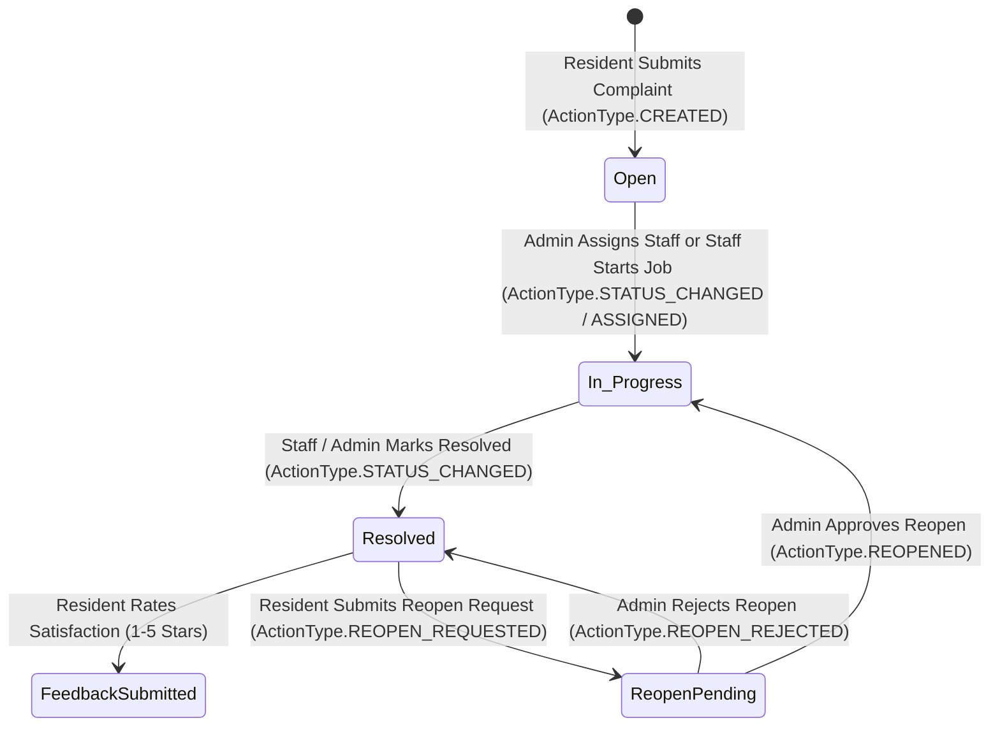
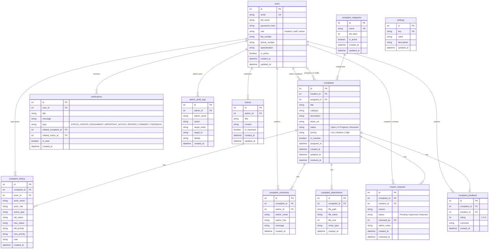

# System Design Document: Homely (Society Maintenance Complaint Tracker & Operations CRM)

## 1. Architectural Overview
The system follows a modular, decoupled full-stack architecture built with a **FastAPI backend** (Python 3.11+), a **Vite + React SPA frontend**, and a **relational database** (SQLite/PostgreSQL) managed via **SQLAlchemy 2.0 ORM**. Role-Based Access Control (RBAC) strictly separates *Resident*, *Maintenance Staff*, and *Admin* workflows using stateless JWT bearer authentication.

```
[React SPA] <---(JWT / REST / Multipart)---> [FastAPI Backend] <---> [SQLAlchemy 2.0 ORM] <---> [Relational DB]
                                                    │
                                                    ├──> [Storage: Local /uploads | Object Storage]
                                                    └──> [Email Service: Resend REST API]
```

---

## 2. RBAC Roles & Capabilities Matrix

```mermaid
graph TD
    User([Authenticated User])
    User -->|Role: resident| Resident[Resident Persona]
    User -->|Role: staff| Staff[Staff Persona]
    User -->|Role: admin| Admin[Admin Persona]

    Resident --> R1[Raise Complaint & Upload Up to 5 Photos]
    Resident --> R2[View Own Complaints & SLA Countdown]
    Resident --> R3[Post Comments & Discuss with Staff/Admin]
    Resident --> R4[Submit 1-5 Star Satisfaction Rating on Resolved]
    Resident --> R5[Submit Reopen Request if Issue Persists]

    Staff --> S1[View Assigned Work Orders Queue]
    Staff --> S2[Update Status: Open -> In Progress -> Resolved]
    Staff --> S3[Post Maintenance Remarks & Coordinate via Discussion]

    Admin --> A1[Assign Staff & Review Reopen Requests]
    Admin --> A2[Configure Category-Specific SLA Days]
    Admin --> A3[Manage Staff Technicians & Onboarding]
    Admin --> A4[Smart Analytics: Resolution Time, Workload, Overdue %]
    Admin --> A5[View Immutable Admin Audit Logs & Export CSV Reports]
    Admin --> A6[Publish Notices & Broadcast Announcements]
```



---

## 3. Complaint Lifecycle State Machine



---

## 4. Category-Specific SLA & Overdue Calculation Engine

Each complaint category has a configured SLA resolution window stored in `complaint_categories` (fallback to global `settings.overdue_threshold_days` or default 7 days):

$$\text{Deadline} = \text{created\_at} + (\text{Category SLA Days} \times 86,400\text{s})$$

$$\text{Remaining Seconds} = \text{Deadline} - \text{Current UTC Time}$$

$$\text{is\_overdue} = (\text{status} \neq \text{'Resolved'}) \land (\text{Remaining Seconds} < 0)$$

- **SLA Status Badges:**
  - `normal`: $\text{Remaining Seconds} > 86,400\text{s}$ (Cyan/Emerald badge)
  - `approaching`: $0 \le \text{Remaining Seconds} \le 86,400\text{s}$ (Amber badge)
  - `overdue`: $\text{Remaining Seconds} < 0$ (Rose/Flame badge)
  - `resolved`: Complaint is resolved (Emerald badge)

---

## 5. Duplicate & Recurring Issue Detection Algorithm

1. **Duplicate Detection:**
   - Evaluates complaints created in the past 30 days within the same category.
   - Computes token overlap (Jaccard similarity $\ge 0.35$) between cleaned title and description keywords.
   - Returns non-blocking potential duplicate list for resident review before final submission.

2. **Recurring Issue Hotspot Detection:**
   - Groups complaints across 30-day windows by Category and Location (Flat or Tower).
   - Identifies clusters with $\ge 2$ occurrences and flags them as recurring maintenance patterns.

---

## 6. Complete Database Schema (Entity-Relationship Diagram)



---

## 7. Secure Photo Pipeline & Verification
- **Validation:** Enforces maximum 5 photos per complaint (&le; 10MB each), whitelisted MIME signatures (`image/jpeg`, `image/png`, `image/webp`).
- **File Sanitization:** Stored with cryptographically generated `UUIDv4` identifiers to eliminate directory traversal risks.
- **Asynchronous Chunk Streaming:** Handled using `aiofiles` in non-blocking 1MB chunks.
